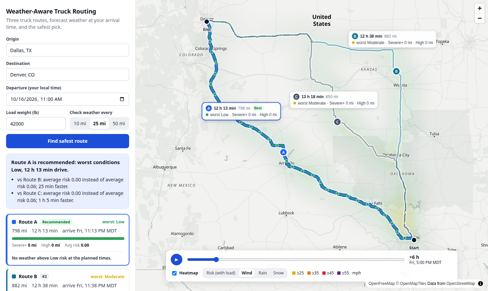

# Weather-Aware Truck Routing

A React + Django app that helps a truck driver choose the safest route. It fetches three truck
routes, checks the forecast at the time the truck will actually reach each point along them,
classifies the risk with the given wind/rain/snow and load rules, and recommends a route that
balances weather risk against travel time.

**Live demo:** http://144.172.91.81:8080



## Features

- **Trip input:** origin and destination (with autocomplete), departure date/time in local time,
  load weight, and checkpoint spacing of 10, 25 or 50 miles.
- **Three route options** from HERE's truck routing, which accounts for the truck's weight.
- **Weather at the truck's ETA** at every checkpoint, from Open-Meteo hourly forecasts.
- **Risk per checkpoint** from the wind/rain/snow bands and load rules, with the reasons shown.
- **Recommendation** ranked by No Travel, Severe and High miles, then average risk, then travel
  time, with a plain-language explanation of each comparison.
- **Map:**
  - all routes, each with a summary card;
  - the selected route's line coloured by risk;
  - risk-coloured checkpoints that show their ETA on hover and full conditions and reasons on click.
- **Corridor heatmap:** risk, wind, rain or snow, with a 0–48 hour slider and play button.
  Truck markers show where each route's truck is at the chosen hour.

## How it works

```
origin, destination, departure, load, spacing
  │
  ├─ HERE geocoding + truck routing ──► up to 3 distinct routes, each with per-segment travel times
  ├─ checkpoints every N miles ───────► position and ETA of each (ETA follows real road speeds)
  ├─ Open-Meteo hourly forecasts ─────► wind, gusts, rain, snow at each checkpoint's ETA
  ├─ risk rules + load rules ─────────► level and reasons per checkpoint
  ├─ per-route totals ────────────────► miles at each level, average risk, worst level
  └─ ranking ─────────────────────────► recommended route + explanation
```

### 1. Routes

- **Request:** HERE Routing v8 with `transportMode=truck` and the truck's gross weight
  (load + 35,000 lb empty tractor-trailer).
- **Travel times:** HERE splits each route into road segments (about 1,800 for Dallas → Denver), each with its own travel
  time. That gives the elapsed time at every point of the route line, so a checkpoint's ETA
  reflects slow city stretches and fast interstate.
- **Filling to three routes:** if HERE returns fewer than three *distinct* routes, extra ones are
  forced through waypoints offset to either side of the trip.
  - Routes sharing ≥ 85% of their corridor count as duplicates; they'd see the same weather.
  - Detours slower than 1.6× the fastest route are dropped.
  - A short trip may end up with only two routes.

### 2. Checkpoints and ETAs

- **Placement:** at 0, N, 2N, … miles along the route, plus the destination.
- **Stretch of road:** each checkpoint stands for the road halfway to its neighbours.
  So the miles at each risk level add up to exactly the route length.
- **ETA:** departure + the elapsed driving time at that mile.

### 3. Weather at the ETA

- **Source:** Open-Meteo hourly forecasts, in mph and inches.
- **Grid:** locations snap to a 0.1° grid (≈ the forecast models' resolution), so checkpoints
  that are close together, even on different routes, share one forecast.
- **Rain and snow** are totals for the hour *ending* at each timestamp.
  So an ETA of 13:20 uses the 13:00–14:00 value.
- **Wind** is an instantaneous value, interpolated between the hours on either side of the ETA.
- **Beyond the forecast range** (16 days): the checkpoint is **Unknown**. Unknown miles are
  reported but left out of the average risk.

### 4. Risk classification

Each checkpoint gets the **worst** of its wind, rain and snow levels.

| Condition | Low | Moderate | High | Severe | No Travel |
| --- | --- | --- | --- | --- | --- |
| Wind (mph) | < 25 | 25 – < 35 | 35 – < 45 | 45 – < 55 | ≥ 55 |
| Rain (in/hr) | < 0.10 | 0.10 – < 0.25 | 0.25 – < 0.50 | 0.50 – 1.00 | > 1.00 |
| Snow (in/hr) | < 0.5 | 0.5 – < 1.0 | 1.0 – < 2.0 | 2.0 – 3.0 | > 3.0 |

The brief's bands share their edges (e.g. rain "0.10–0.25" and "0.25–0.50"), so a value on an
edge goes in the **higher** band. The top band follows the brief's wording exactly: wind is No
Travel at ≥ 55 mph, while rain and snow are No Travel only *above* 1.00 and 3.0 in/hr.

**Load rules** can only raise a level, never lower it:

| Wind | Load | Result |
| --- | --- | --- |
| ≥ 55 mph | any | No Travel |
| 45 – 54 mph | > 30,000 lb | No Travel |
| 35 – 44 mph | > 40,000 lb | Severe |

"More than" is taken literally: exactly 30,000 or 40,000 lb does not trigger a rule. Every
checkpoint reports the reasons for its level, e.g.
*"Wind 47.0 mph: Severe; Load 42,000 lb > 30,000 lb in 45-54 mph wind: No Travel"*.

### 5. Recommendation

Routes are compared on these criteria, in order; the first one that separates two routes decides:

1. fewest **No Travel** miles *(added: strictly worse than Severe, so it must rank first)*
2. fewest **Severe** miles
3. fewest **High** miles
4. lowest **average risk** (distance-weighted, Low = 0 … No Travel = 4)
5. shortest **travel time**

**Ties:** differences of ≤ 1 mile, or ≤ 0.05 average risk, count as ties, so the next criterion
decides. Without this, a fraction of a mile of sampling noise could outweigh hours of driving.
This is how "balancing weather risk and travel time" is applied.

**Explanation:** the result explains each comparison, e.g.
*"vs Route A: 0 Severe miles instead of 40 Severe miles; 1 h 15 min longer."*

**Warnings:**
- every route crosses No Travel conditions (suggests delaying departure);
- the recommended route still has Severe weather;
- some miles are beyond the forecast range.

### 6. Heatmap and slider

- **Grid:** points within 30 miles of any route.
  - Spacing starts at 0.1° and coarsens (up to 1°) until the grid has ≤ 200 points.
  - This keeps long trips within Open-Meteo's free-tier limits.
- **Data:** each point carries 49 hourly values (departure + 0…48 h) of risk with the load rules
  applied, wind, rain and snow. All of it arrives in one response.
- **Slider:** moving it only swaps a map paint expression on the GPU; no new request is made.
- **Truck markers:** placed from the per-point elapsed times in the route data.
- **Load order:** routes appear as soon as `/api/plan/` returns; the heatmap loads after.

## Assumptions and decisions

| Topic | Decision |
| --- | --- |
| Checkpoint spacing | "10 / 25 / 50 miles" is a user choice (default 25). |
| Wind | Classified on sustained wind (as the rules say "wind"); gusts are shown alongside. |
| Truck weight for routing | Load + 35,000 lb typical empty tractor-trailer, sent as gross weight. |
| Band edges | Lower bound inclusive; top band as worded in the brief (see above). |
| No Travel in ranking | Ranked before Severe miles. |
| Tie tolerances | 1 mile / 0.05 average risk. |
| Heatmap time axis | Hour 0 is the departure time, so the slider follows the trip. |
| Departure | Must be between now (1 h grace) and 14 days ahead, within forecast range. |
| Driver hours of service | Not modelled; ETAs are continuous driving time. |

## Project layout

```
backend/                      Django + Django REST Framework
  config/settings.py          env-based settings (.env)
  routing/views.py            /api/geocode/, /api/plan/, /api/heatmap/
  routing/serializers.py      input validation, response shaping
  routing/services/
    here.py                   HERE geocoding + truck routing client (cached)
    routing.py                routes with per-point time, detours, de-duplication
    sampling.py               checkpoints, ETAs, road coverage
    weather.py                Open-Meteo client: grid snapping, batching, cache, ETA lookup
    risk.py                   risk bands and load rules (pure functions)
    assessment.py             per-checkpoint risk and per-route totals
    recommend.py              ranking and explanation (pure functions)
    heatmap.py                corridor grid and hourly values
    geo.py                    distance, interpolation, line simplification
  tests/                      106 pytest tests (no network)
frontend/                     React + TypeScript + Vite, MapLibre GL
  src/App.tsx                 state and data flow
  src/components/             TripForm, PlaceInput, MapView, RouteCards,
                              RecommendationPanel, TimeControls
  src/lib/                    risk colours/scales, geometry, formatting
deploy/                       VPS deployment (gunicorn + nginx), see deploy/README.md
```

### API

| Endpoint | Purpose |
| --- | --- |
| `GET /api/geocode/?q=Dallas` | Up to 5 matching places `{label, lat, lon}` |
| `POST /api/plan/` | `{origin, destination, departure, load_lb, interval_mi}` → routes with geometry, checkpoints, summaries and the recommendation. Origin/destination may be a place name or `{lat, lon}`. |
| `POST /api/heatmap/` | `{routes, departure, load_lb}` → corridor grid with 49 hourly values per point |
| `GET /api/health/` | Liveness check |

Invalid input returns 400 with a message per field. A failure at HERE or Open-Meteo returns 502
with a readable message (e.g. Open-Meteo's per-minute rate limit).

## Running locally

Requirements: Python 3.12+, Node 22+, a free [HERE](https://platform.here.com) API key
(Access Manager → Apps → Credentials → API Keys). Open-Meteo needs no key.

```bash
# Backend (http://127.0.0.1:8000)
cd backend
python3 -m venv .venv && source .venv/bin/activate
pip install -r requirements.txt
cp .env.example .env          # then set HERE_API_KEY in .env
python manage.py runserver

# Frontend (http://localhost:5173), in a second terminal
cd frontend
npm install
npm run dev
```

The Vite dev server proxies `/api` to Django, so the browser sees a single origin.
The map needs a browser with WebGL2 (hardware acceleration enabled).

## Tests

```bash
cd backend && .venv/bin/pytest          # 106 tests, ~0.5 s, no network needed
cd frontend && npx tsc -b && npx oxlint  # type check and lint
```

The backend tests cover:
- every band boundary and load-rule edge;
- ETA interpolation and the hour-ending rule for rain and snow;
- how checkpoints cover the route;
- duplicate and detour handling;
- ranking order and tie tolerances;
- forecast-horizon handling;
- the API contract, with fake routing and weather clients.

## Deployment

The hosted app runs on an Ubuntu VPS: gunicorn behind nginx, which also serves the built
frontend on the same origin. `deploy/deploy.sh` installs or updates everything and is written
to coexist with other apps on the server. See [deploy/README.md](deploy/README.md).

## Limitations

- Forecast quality limits the result: beyond a few days, hourly precipitation is uncertain.
- Weather is sampled at checkpoints. Narrow storm cells between checkpoints can be missed at
  50-mile spacing; 10 miles is the most thorough.
- Open-Meteo's free tier allows about 600 locations per minute. Responses are cached for an
  hour, but heavy concurrent use can hit the limit (the user sees a "try again in a minute"
  message).
- Hours-of-service breaks are not modelled, so ETAs late in long trips are earlier than a real
  driver would arrive.
